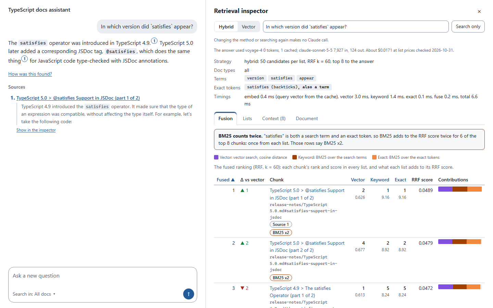

# Docs RAG Lab

Interview preparation and docs Q&A grounded in official technical documentation.

Docs RAG Lab is a local RAG engine over the TypeScript and React documentation. It comes with:

- docs assistants that answer with native citations to exact doc sections;
- an inspector that shows how every answer was retrieved;
- an evaluation harness that measures each retrieval technique against honest baselines;
- an interview-prep app with compiler-verified questions.

Everything runs locally. There is no deployment. The full design is in [SPEC.md](SPEC.md).

## Status

**M6 (React, through `/add-source`) is done.** v1.0 is M5 through M9, so next come the compiler's output in the chunks, the interview-prep app and agentic mode. The MCP server and more sources moved to later ([ADR-0015](docs/adr/0015-v1-scope-and-a-lighter-process.md)). TypeScript's results come first and React's follow. They are different questions on different docs, and their numbers are never compared.

The milestones are in [SPEC.md section 13](SPEC.md#13-milestones). Notes and metrics per milestone, including the first full index, are in [docs/journal.md](docs/journal.md).

Every claim about retrieval quality is backed by a measured row in the tables below, and every report behind one is in [eval/reports/](eval/reports/).

### TypeScript

**M5 (rerank and contextual retrieval) is done.** Five rows of the strategy ladder are measured on a frozen golden set of 40 TypeScript questions and 5 the docs do not answer, at docs commit `205122bb`.

| Row | Right chunk in top 8 | How high it ranks (MRR) | Fully correct, may run high | All citations hold | Cites the right passage | Wrongly refused, fewer is better | Time and cost per answer |
|---|---|---|---|---|---|---|---|
| 0, Claude without RAG | no retrieval | no retrieval | 36 of 40 (77-96%) | cannot: no docs | cannot: no docs | 1 of 40 (0-13%) | 3.9 s (3.6-4.2), $0.004 ($0.004-0.005) |
| 2, vector | 36 of 40 (77-96%) | 0.751 (0.63-0.86) | 36 of 40 (77-96%) | 38 of 40 (83-99%) | 35 of 40 (74-95%) | 1 of 40 (0-13%) | 4.2 s (3.8-4.5), $0.022 ($0.021-0.022) |
| 3, hybrid | 36 of 40 (77-96%) | 0.657 (0.55-0.76) | 34 of 40 (71-93%) | 33 of 40 (68-91%) | 36 of 40 (77-96%) | 2 of 40 (1-17%) | 4.7 s (4.2-5.2), $0.023 ($0.022-0.023) |
| 4, hybrid + rerank | 39 of 40 (87-100%) | 0.867 (0.78-0.94) | 36 of 40 (77-96%) | 36 of 40 (77-96%) | 38 of 40 (83-99%) | 1 of 40 (0-13%) | 4.7 s (4.2-5.2), $0.023 ($0.022-0.024) |
| 5, hybrid + rerank + contexts | 39 of 40 (87-100%) | 0.886 (0.80-0.96) | 37 of 40 (80-97%) | 33 of 40 (68-91%) | 38 of 40 (83-99%) | 0 of 40 (0-9%) | 4.7 s (4.3-5.1), $0.023 ($0.022-0.024) |

Each number has its 95% interval beside it: Wilson for a count, a seeded bootstrap over questions for a mean. All five rows refused all 5 questions the docs do not answer, 5 of 5 (57-100%). Time and cost are from when each answer was first made, since the final run read them from the cache. Time leaves out retrieval, and with it the rerank call.

**What M5 found:**
- **Rerank gave a significant retrieval gain with no regressions, and it did not reach the answers.** Against hybrid, the right chunk comes first on 31 of 40 questions instead of 19 (rerank ahead on 12, hybrid on 0, p < 0.01), MRR goes from 0.657 to 0.867 (18 to 0, p < 0.01), and no question gets worse on any retrieval metric. On answers no difference from hybrid holds up. Fully correct is 36 against 34, at 3 to 1, which is noise, and Claude without docs is at 36 too. All citations hold is 36 against 33, at 7 to 4, not significant, and the second runs go the other way, 33 against 38. So the app stays on hybrid: a gain that did not reach the answers does not justify a rate-limited dependency in the chat path. The inspector's Reranker tab shows on demand what rerank would change.
- **The Haiku contexts added nothing significant on chunks that already carry their headings.** Every chunk here starts with a line `document > sections`. Alone, contexts take MRR from 0.657 to 0.693 (11 to 5, p = 0.21, not significant). On top of rerank they take it from 0.867 to 0.886 (3 to 2, noise). Nor are they shown to beat a prefix written by code from the headings (12 to 4, p = 0.08, not significant). This is about these docs, on 40 questions.
- **A hard per-question gate vetoed a significant set-level gain.** The criteria, fixed before any run, asked for all five target rows from M2. Rerank met 4, and ts-0033 stayed at rank 3 against a target of 1. So rerank is not accepted under [ADR-0014](docs/adr/0014-rerank-and-contextual-retrieval.md), and the criteria did not change after the result. The lesson is for later ADRs: set-level criteria decide, and per-question targets are diagnostics.

**"Up to about a minute" is free-tier pacing, not the reranker.** The Reranker tab warns of that wait because the free trial allows 10K tokens a minute and one call weighs about that much. One uncached call in the live check took 359 ms for 10,725 tokens, with nothing to wait for. That is one call and not a latency measurement. It changes nothing above, since what decided the app is that the gain did not reach the answers.

**Correctness may run high, in every row.** An LLM judge grades the answers, and a human checks the judge on samples labelled without seeing its verdicts. The first round missed the bar on correctness, at 10 of 12. The prompt then stated the rubric outright, and a fresh blind round, under a rule fixed before it, agreed on 9 of 10 (60-98%). Refusals, at 15 of 15 (80-100%), and citations, at 8 of 8 (68-100%), keep their first-round results. The new prompt changed only 1 of 120 verdicts, so that pass reflects another sample of answers and not a better judge. M5's round, on 15 fresh answers from rows 4 and 5, also passed: correctness 11 of 12 (65-99%), refusals 15 of 15 (80-100%), support 11 of 12 (65-99%). All 4 disagreements on correctness across the blind rounds are the judge scoring higher than the human, so correctness may be slightly inflated.

What else the numbers say:
- **No difference between vector and hybrid holds up.** Compared question by question with an exact sign test: on MRR vector is ahead on 14, hybrid on 7, with 19 tied, p = 0.19, not significant. On fully correct it is 2 to 0, which is noise. On all citations hold it is 5 to 0, p = 0.06, not significant, and hybrid differs from itself on 5 questions between two runs. Counted per claim, the report's verdict is vector better, 7 to 0, p = 0.016, but against hybrid's second run it is 2 to 0, and hybrid differs from itself by 1 to 5, so that is run-to-run noise and not a difference between the rows ([ADR-0012](docs/adr/0012-answer-metrics-and-the-judge.md)). M4 left hybrid the default, and M5 did not change that.
- **On this set, Claude without docs is about as correct as RAG,** so correctness alone does not show what RAG adds. What RAG adds is grounding: most of its answers cite passages that hold. More questions whose answers changed after the models' training cutoff are a candidate for golden set v2.
- **Correct and grounded, exploratory and no target, may run high:** an answer that scores 2, has every cited claim supported and cites an anchor. It was defined after seeing results. Vector has 31 of 40 (62-88%), hybrid 28 of 40 (55-82%) and, on its second run, 32 of 40 (65-90%), so it does not separate them. Vector 5, hybrid 2, p = 0.45, not significant. Rerank has 32 of 40 (65-90%) and then 29, rerank + contexts 29 of 40 (57-84%) and then 30, and no verdict names a row. Row 0 cannot score by design.
- **Of the five target rows from M2, hybrid meets 2, rerank 4 and rerank + contexts 3.** Rerank reaches ts-0027 and ts-0004, and rerank + contexts misses ts-0004 at rank 3 against 2. Three fixes to the keyword search were tested under criteria fixed first and not adopted ([ADR-0011](docs/adr/0011-retrieval-hypotheses.md), ADR-0014).

The numbers come from [the final report](eval/reports/typescript/2026-11-04-6b2d15f7-final.md), except row 5's retrieval, which reads another index and has [a report of its own](eval/reports/typescript/2026-11-04-d93f3325-m5-contextual.md). The comparisons of contexts alone and of the prefix from the headings are in ADR-0014, from that report and [the control's](eval/reports/typescript/2026-11-04-62a32167-m5-control.md). `drl eval verify` reproduced the retrieval of both byte for byte on the same vectors. On other vectors only the conclusions are promised, and the M4 baseline's held from a clean worktree with no data ([ADR-0010](docs/adr/0010-eval-reports-and-reproducibility.md)). Answers do not repeat, so they are stored in the report. `pnpm dev` serves all of this at `/eval`, with the tables per tag, the diffs per question and a comparison of any two runs behind one button.

**M3 gave it an app.** `pnpm dev` starts a TypeScript docs assistant on http://127.0.0.1:3000:

- a streaming answer with numbered citations to the exact doc sections;
- a retrieval inspector that opens on demand, from "How was this found?" under an answer or from a citation. It shows every candidate list, the fused ranking with each list's part of the RRF score, the chunks sent to Claude, and where each chunk of a document starts and ends;
- a Hybrid/Vector toggle and "Search only" in the inspector's header, which re-run the retrieval without calling Claude;
- a Reranker tab in the inspector, which shows on demand what the reranker would change on this search. It makes one free Voyage call and no Claude call, and the chat stays on hybrid ([ADR-0014](docs/adr/0014-rerank-and-contextual-retrieval.md)).

<picture>
  <source media="(prefers-color-scheme: dark)" srcset="docs/images/ts-docs-dark.png">
  
</picture>

The fusion view shows BM25 counted twice: `satisfies` is both a search term and an exact token, and the vector search's top hit falls to third. Removing that second count was tested in M4 and not adopted: it wins some questions, loses others, and reaches none of the three targets (ADR-0011). The inspector is keyboard-accessible, never shows state by colour alone, and reflows at 320 CSS px (1280 px at 400% zoom). Every ui component state is a Storybook story that runs as a test in Chromium, with axe, in light and dark.

Before M3:
- M1 synced the TypeScript docs incrementally, embedded them with Voyage through a shared cache, and answered with native citations from `drl ask`, with tokens and cost after every command.
- M2 added hybrid search (FTS5 BM25 and exact tokens fused with vector search by Reciprocal Rank Fusion), doc type filters and the retrieval trace.

### React

**M6 added React, with an app of its own.** `pnpm dev:react` starts it on http://127.0.0.1:3001. Four rows are measured on 16 questions and 4 the docs do not answer, at docs commit `2177e28d`, by a test fixed first in [ADR-0016](docs/adr/0016-react-source-and-its-test.md).

**What this set is.** Claude drafted it from the docs' text, with no retrieval and no answer read. The owner reviewed the 10 flagged questions and decided the anchors of 4 others, and the other 6 were frozen unread (ADR-0015). 10 of the 16 are `fresh`: they come from the newest parts of the docs, by a walk down git history back to 2026-06-24. So the overall numbers describe a set weighted towards new pages, not the docs at large. Fresh means newest in these docs, and not past the model's training cutoff.

**Do not read this table across to TypeScript's.** It has the same columns, but these are other questions on other docs, and the set is weighted as above.

| Row | Right chunk in top 8 | How high it ranks (MRR) | Fully correct, may run high | All citations hold | Cites the right passage | Wrongly refused, fewer is better | Time and cost per answer |
|---|---|---|---|---|---|---|---|
| 0, Claude without RAG | no retrieval | no retrieval | 7 of 16 (23-67%) | cannot: no docs | cannot: no docs | 5 of 16 (14-56%) | 4.2 s (3.8-4.7), $0.004 ($0.004-0.005) |
| 2, vector | 16 of 16 (81-100%) | 0.859 (0.73-0.97) | 15 of 16 (72-99%) | 15 of 16 (72-99%) | 16 of 16 (81-100%) | 0 of 16 (0-19%) | 4.1 s (3.3-4.9), $0.020 ($0.019-0.021) |
| 3, hybrid | 14 of 16 (64-97%) | 0.726 (0.54-0.90) | 13 of 16 (57-93%) | 15 of 16 (72-99%) | 15 of 16 (72-99%) | 1 of 16 (1-28%) | 4.3 s (3.5-5.2), $0.020 ($0.019-0.022) |
| 4, hybrid + rerank | 16 of 16 (81-100%) | 0.969 (0.91-1.00) | 14 of 16 (64-97%) | 16 of 16 (81-100%) | 16 of 16 (81-100%) | 0 of 16 (0-19%) | 4.6 s (3.8-5.5), $0.021 ($0.020-0.022) |

Each number has its 95% interval beside it, as in the table above. Time and cost are from when each answer was first made, since the named run read a pilot's answers from the cache, and time leaves out retrieval, and with it the rerank call. On the 4 questions the docs do not answer, rows 3 and 4 refuse rightly on all 4 (51-100%), and rows 0 and 2 on 3 (30-95%). Row 2's fourth is a judge's error, below.

Row 0's 7 of 16 is 2 of 10 on fresh (6-51%) and 5 of 6 on the rest (44-97%). Hybrid's 13 is 9 of 10 (60-98%) and 4 of 6 (30-90%). This describes the set and decides nothing.

**What M6 found:**
- **On the newest docs, RAG beats Claude's memory, by the rule fixed first.** On the 10 fresh questions hybrid is fully correct on 9 (60-98%) and Claude without docs on 2 (6-51%), and both may run high. Hybrid is ahead on 7, Claude on 0, with 3 tied, p = 0.016. Hybrid does not differ from itself on that tag between two runs. The judge's second opinion on row 3 moves one of those answers, and with that grade it is 8 of 10, at 6 to 0, p = 0.03. Of the 7, Claude declined to answer on 4 and answered in part on 3: all 5 of its zeros are refusals, and none is a wrong answer. Over all 16 it is 13 against 7, at 7 to 1, p = 0.07, not significant. If anything this is conservative: the judge's own knowledge is older than the docs, which on fresh pages biases it against RAG. The one verdict that shows this is on another question, below, so it gives a direction and no number.
- **Rerank's retrieval gain is not repeated, by the rule written first.** MRR goes from 0.726 (0.54-0.90) to 0.969 (0.91-1.00), at 6 to 0, p = 0.03, which names rerank. The right chunk comes first on 15 (72-99%) instead of 10 (39-82%), at 5 to 0, p = 0.06, not significant, and the rule asks for both. Hybrid is not first on 6 questions, so this metric could be significant only if rerank moved all 6, and it moved 5. Hybrid is ahead on no question, on any retrieval metric.
- **It did not reach the answers, so this app stays on hybrid.** Fully correct is 14 against 13, at 2 to 1. All citations hold is 16 against 15, at 1 to 0. Wrongly refused is 0 against 1, at 1 to 0. All three are noise.
- **No difference between vector and hybrid holds up.** MRR is 4 to 2, right chunk in top 8 is 2 to 0, and fully correct is 2 to 0. Hybrid misses the top 8 on react-0007 and react-0011. On react-0011, in Russian, its answer refuses wrongly in both runs, the only wrong refusal in any row that reads the docs. Keyword search pushes the right chunk down here, as on ts-0004 and ts-0038 in TypeScript's set. Nothing is tuned for this, and [the journal](docs/journal.md) has the hypothesis to test.
- **A status is easy to leave out.** A fresh question about an experimental API has an expected answer that states that, and without it the answer scores at most 1. Asked how to set up an experimental tool, no row says it is experimental, so no row can pass 9 of 10 on `fresh`. Two cases of known grade show that the judge enforces this, and the four answers that state it on another question scored 2.

**How far to trust the judge here.** It was calibrated on TypeScript's answers and spot-checked on these: the owner labelled 10 answers blind, and it agreed on correctness 8 of 8 (68-100%), refusals 10 of 10 (72-100%) and citations 5 of 6 (44-97%), being the stricter one on that one. The owner marked all 6 as supported, so this sample has no case of a claim the owner found unsupported. One verdict outside that sample is wrong on reading: it calls `use(browser())` made up, though the answer cites a passage that is in the docs. The API is newer than what the judge knows, and it sees the cited passage but not the docs, so it cannot tell a real passage from a made-up one. That verdict is in row 2, which decides nothing, and it stands.

The numbers come from [React's report](eval/reports/react/2026-11-05-8dfcae6f-m6.md). `drl eval verify` reproduced its retrieval byte for byte on the same vectors, and answers do not repeat, so they are stored in the report. `pnpm dev:react` serves it at `/eval`. It cost $4.08 of Claude at list prices.

## Requirements

- Node 26.13.0, the current LTS. It is pinned in `.nvmrc`, and `pnpm install` refuses anything outside `^26.13.0`.
- pnpm 12.16.1 (`npm i -g pnpm@12.16.1`). Node 26 does not bundle corepack.
- git on the PATH, for syncing doc sources.
- For the ui story tests: Playwright's headless Chromium, installed once with `pnpm --filter @docs-rag-lab/ui exec playwright install --only-shell chromium`.
- For `drl` and the app only: an Anthropic API key and a Voyage key created in MongoDB Atlas (AI Model APIs). Copy `.env.example` to `.env` and fill it in; the CLI loads it itself. Without a payment method on the Atlas org, Voyage allows 3 requests and 10K tokens per minute, so the first full index takes about an hour; the limits are in `packages/settings/src/settings.ts`.

## Quickstart

```sh
pnpm install
pnpm format:check
pnpm turbo run lint typecheck test build
```

These are the same checks CI runs, and they need no API keys. Then, with keys:

```sh
pnpm test:network                 # one tiny Voyage call and one tiny Claude call
pnpm drl sync typescript          # clone, parse, chunk and embed (incremental after the first run)
pnpm drl ask "What is the difference between unknown and any?"
pnpm dev                          # the docs assistant on http://127.0.0.1:3000
```

## Commands

| Command | What it does |
|---|---|
| `pnpm install` | Install all workspace dependencies |
| `pnpm turbo run lint typecheck test build` | Lint, typecheck, tests and the app's `next build`. Both `lint` and `test` include the dependency-cruiser boundary check. CI runs this plus `pnpm format:check` |
| `pnpm turbo run test --filter=@docs-rag-lab/core` | Tests for one package. Also works with `lint` and `typecheck` |
| `pnpm turbo run test "--filter=...[HEAD]"` | Tests for packages changed since HEAD and their dependents |
| `pnpm depcruise` | Boundary check only |
| `pnpm format` | Format with Prettier |
| `pnpm format:check` | Check Prettier formatting, then check that no file contains an em dash |
| `pnpm turbo gen source` | Scaffold a source in `packages/sources/<id>`: it asks for the id, repository, branch, site, directories, license and attribution, or takes them with `--args`. Its parser refuses every file until it is written |
| `pnpm drl sync typescript [--full] [--at <sha>]` | Sync the TypeScript docs into `data/sources/typescript.sqlite`, at the head of the branch or at that commit (the next sync without `--at` returns to the head). Re-embeds only new or changed chunks |
| `pnpm drl sync typescript --contextual [--pilot <n>] [--yes]` | Build the second index of [ADR-0014](docs/adr/0014-rerank-and-contextual-retrieval.md), `data/sources/typescript.contextual.sqlite`, at the plain index's commit: Claude writes a context per chunk, kept under `eval/contexts/`, and each chunk is embedded with its context. Spends real tokens: without `--yes` it prints the estimate and stops. `--pilot` writes contexts for a few chunks and prints them with the forecast. Reruns call nothing for what the file and the cache hold |
| `pnpm drl sync typescript --control [--yes]` | The same with the prefix `title > section path` from code, and no call to Claude, in `data/sources/typescript.control.sqlite`. It is the control for the contexts |
| `pnpm drl sync typescript --compiled [--yes]` | Compiles every twoslash example with the docs' own `typescript` 6.0.2, records what did not compile under `eval/compile/`, and stops below 90% compiled. With `--yes` it builds `data/sources/typescript.compiled.sqlite`, where the compiler's output follows each example ([ADR-0017](docs/adr/0017-twoslash-compile-and-its-test.md)). No call to Claude |
| `pnpm drl ask "<question>" [--strategy vector\|hybrid\|rerank] [--doc-type <type>] [--top-k <n>] [--verbose]` | Answer from the docs with numbered citations; `--verbose` prints the retrieval trace first |
| `pnpm drl search "<question>" [--strategy vector\|hybrid\|rerank] [--doc-type <type>] [--json]` | Retrieval only, no Claude call: print the retrieval trace, or with `--json` the whole trace as JSON |
| `pnpm drl limits` | Show what the Voyage endpoint says about rate limits (one tiny request per model) |
| `pnpm drl eval [--name <name>] [--strategy vector\|hybrid\|rerank] [--contextual] [--control] [--yes]` | Retrieval metrics over the golden set, written as a report under `eval/reports/`. No Claude call. A named run is committed; without a name it goes to `dev/`, which git ignores. A named run measures rerank too, in one paced call per question: without `--yes` it prints the estimate for the calls that are not cached, and stops. On a cold cache the queries are embedded first, in one free request, and it says so. `--contextual` and `--control` measure those indexes, the control under `vector` and `hybrid` only. A run that survived 429s says so in its output and its report |
| `pnpm drl eval verify <report> [--record]` | Run a report again and say whether it reproduces. `--record` writes what it found next to the report, for the dashboard |
| `pnpm drl eval compare <a> <b> [--strategies <x>,<y>]` | Compare two reports question by question, and mark what is noise. `--strategies hybrid,rerank` compares a's `hybrid` with b's `rerank`, instead of like with like |
| `pnpm drl eval answers [--rows <list>] [--only <ids>] [--noise] [--name <name>] [--yes]` | Answer metrics. Spends real tokens: without `--yes` it prints the estimate and stops. Reruns pay only for what is not cached. Rows 0, 2 and 3 by default. Row 4 reranks, and row 5 reranks on the contextual index, so they are asked for by name, and any rerank calls not yet cached come first, with `--yes` |
| `pnpm drl eval judge-check --yes` | The judge on answers whose grade is known. Spends real tokens |
| `pnpm drl eval rerank-check` | How a rerank score depends on the rest of its call ([ADR-0014](docs/adr/0014-rerank-and-contextual-retrieval.md)). Prints its plan, and takes about 15 minutes of free tokens with `--yes` |
| `pnpm drl eval label <report> [--after <report>] [--rows <list>] [--spot]` | The sheet a human labels from, with no verdicts. `--rows 4,5` takes 15 answers from those rows, and `--spot` the 10 of a spot check |
| `pnpm drl eval spot-check <report> <labels>` | How often those 10 labels agree with the judge on a source's own answers ([ADR-0016](docs/adr/0016-react-source-and-its-test.md)). It has a file of its own and decides no calibration |
| `pnpm drl eval calibrate <report> <labels> [--after <report>] [--sample-of <report>] [--rows <list>]` | How often the labels agree with the judge. Also writes what named reports' markdown says of the judge |
| `pnpm drl eval check [--accept]` | Check the golden set against the index, with no API calls: which questions are stale, and which anchors changed since the lock |
| `pnpm drl eval check --draft` | The same for `eval/questions.draft.jsonl`: which anchors do not resolve and what each question copies from the pages it is anchored to, and it fails above 2 fresh questions on a page ([ADR-0016](docs/adr/0016-react-source-and-its-test.md)) |
| `pnpm drl eval walk [--top <n>]` | Every indexed page and heading, newest first by git history at the index's commit, to pick fresh questions from ([ADR-0016](docs/adr/0016-react-source-and-its-test.md)). It clones the docs' history once, under the cache, and looks at no question or ranking |
| `pnpm test:network` | Opt-in network smoke test: one tiny embedding and one tiny Claude call. Never runs in CI |
| `pnpm dev` | The ts-docs app on http://127.0.0.1:3000, after `drl sync typescript`. Asking spends tokens; the inspector's toggle and Search only make no Claude call, its Reranker tab makes one free Voyage call and no Claude call, and `/eval` only reads committed reports |
| `pnpm dev:react` | The react-docs app on http://127.0.0.1:3001, after `drl sync react`. It has the same routes and costs as `pnpm dev` |
| `pnpm storybook` | Storybook for the ui package on http://127.0.0.1:6006, with the accessibility panel |

Every `drl` command that calls an API ends with a line of tokens used and estimated cost at list prices. It also stops before its next paid call if HEAD or the branch changes under it, so that a report cannot name the wrong commit ([ADR-0010](docs/adr/0010-eval-reports-and-reproducibility.md)).

## Repository layout

| Path | Package | Purpose |
|---|---|---|
| `apps/ts-docs` | `@docs-rag-lab/ts-docs` | TypeScript docs assistant and eval dashboard: a Next.js app, its config and its routes |
| `apps/react-docs` | `@docs-rag-lab/react-docs` | React docs assistant and eval dashboard: the same, for the React docs |
| `packages/docs-server` | `@docs-rag-lab/docs-server` | What the docs apps share on the server: route handlers, the engine's one instance, where the eval reports are |
| `packages/core` | `@docs-rag-lab/core` | Ingest, embeddings and the embedding cache, retrieval, generation, eval runner |
| `packages/source-kit` | `@docs-rag-lab/source-kit` | Source interface, git sync, hashing, chunker, conformance suite |
| `packages/sources/typescript` | `@docs-rag-lab/source-typescript` | TypeScript-Website parser |
| `packages/sources/react` | `@docs-rag-lab/source-react` | react.dev parser |
| `packages/db` | `@docs-rag-lab/db` | SQLite schema, migrations, typed queries |
| `packages/contracts` | `@docs-rag-lab/contracts` | Data shapes that cross boundaries: retrieval trace, citations, answer events |
| `packages/settings` | `@docs-rag-lab/settings` | Engine settings shared by the CLI and apps: models, prices, limits |
| `packages/ui` | `@docs-rag-lab/ui` | Client components: chat, citations, the retrieval inspector, the eval dashboard, with Storybook |
| `packages/cli` | `@docs-rag-lab/cli` | The `drl` CLI |
| `packages/config` | `@docs-rag-lab/config` | Shared tsconfig, ESLint and Vitest presets; dependency-cruiser rules |
| `tooling/claude-hooks` | `@docs-rag-lab/claude-hooks` | Claude Code hooks |
| `tooling/repo-checks` | `@docs-rag-lab/repo-checks` | Repository checks (no em dashes) |
| `tooling/generators` | `@docs-rag-lab/generators` | `turbo gen source`, which scaffolds a source |
| `eval/` | | Committed reports, the contexts of the contextual index and the human labels that check the judge |
| `docs/adr` | | Architecture decision records |

The interview-prep app arrives in M8. The MCP server comes later, after v1.0.

## Architecture boundaries

Enforced by dependency-cruiser on every `lint` run, locally, in CI and in the Claude Code PostToolUse hook:

- Apps import packages. Packages never import apps, and apps never import other apps.
- `sources/*` import only `source-kit`.
- `core` imports only `source-kit`, `db`, `contracts`, and types from `settings`.
- `docs-server` imports only `core`, `contracts` and `settings`.
- `source-kit`, `db`, `contracts` and `settings` import no internal package. `contracts` imports no npm package or Node.js built-in either.
- `ui` is client-safe: of the internal packages it imports only `contracts`, and no Node.js built-ins.
- A package is imported only through its public `src/index.ts`. The one exception is ui's `tokens.css`, which an app's global stylesheet imports.

Each rule is tested against a fixture tree of deliberate violations: [packages/config/test/dependency-cruiser.test.ts](packages/config/test/dependency-cruiser.test.ts). The reasons behind the rules are in [ADR-0002](docs/adr/0002-boundaries-and-hooks.md). The stack choices, such as TypeScript 6.0 rather than 7, are in [ADR-0001](docs/adr/0001-stack.md). Why the chunker lives in source-kit and the embedding cache in core is in [ADR-0003](docs/adr/0003-source-kit-and-core-split.md). The ingest design (chunk IDs, incremental sync, rate limits, cost reporting) is in [ADR-0004](docs/adr/0004-ingest-design.md). Hybrid retrieval and the trace are in [ADR-0005](docs/adr/0005-hybrid-retrieval-and-trace.md), the contracts package and the answer events in [ADR-0006](docs/adr/0006-contracts-package.md), the settings package in [ADR-0007](docs/adr/0007-settings-package.md), the app and ui stack (localhost binding, safe markdown, accessibility, stories as tests) in [ADR-0008](docs/adr/0008-ts-docs-app-and-ui.md), golden sets and their anchors in [ADR-0009](docs/adr/0009-golden-sets-and-anchors.md), and eval reports and what reproducible means in [ADR-0010](docs/adr/0010-eval-reports-and-reproducibility.md). How answers are graded and the judge is checked is in [ADR-0012](docs/adr/0012-answer-metrics-and-the-judge.md), and the dashboard's rules are in [ADR-0013](docs/adr/0013-eval-dashboard.md). The test of rerank and contextual retrieval is in [ADR-0014](docs/adr/0014-rerank-and-contextual-retrieval.md), and the scope of v1.0 and the process from M6 are in [ADR-0015](docs/adr/0015-v1-scope-and-a-lighter-process.md).

## How this repo is built with Claude Code

The Claude Code setup is part of the project, and it is kept small and real.

- **Instructions:**
  - [CLAUDE.md](CLAUDE.md), under 200 lines: commands, boundaries, definition of done, and the Never list;
  - nested `CLAUDE.md` files in `packages/core`, `packages/sources`, `packages/ui` and `apps`, which load when Claude works there;
  - a path-scoped rule for tests: [.claude/rules/testing.md](.claude/rules/testing.md).
- **Skills:**
  - [add-source](.claude/skills/add-source/SKILL.md), which only a person can start, takes a new source from `turbo gen source` to measured numbers;
  - [write-eval-questions](.claude/skills/write-eval-questions/SKILL.md) drafts golden questions from the docs' text alone, with no retriever in the loop, and flags what a person has to review.
- **Subagent:** [code-reviewer](.claude/agents/code-reviewer.md) does a fresh-context review against the boundaries, ADRs and tests before each milestone is committed. In M0 it found a way to launder any import through the config package; that hole is now a tested rule.
- **Hooks** ([.claude/settings.json](.claude/settings.json), code in `tooling/claude-hooks`, unit-tested):
  - **PreToolUse** blocks tool calls that name a dotenv file (case-insensitive; the committed example is allowed). It also blocks file-tool writes under `data/` and `.cache/`.
    - It matches text, so it cannot see through shell globs such as `cat .e*`.
    - The permission deny rules in the same file are a second layer.
  - **PostToolUse** runs lint, typecheck and the boundary check for the package Claude just edited. Errors go straight back to Claude. It takes about 2.7s per edit for most packages and a median of 4.5s for ui, whose type-aware React lint is the slowest (1-2s when cached).
  - **Stop** runs the tests and the boundary check for changed packages before Claude finishes, and always the ts-docs tests, whose check of the global stylesheet covers every app. For ui that includes every story in Chromium, with axe. This also covers edits made through the shell, which skip PostToolUse. It blocks once, then only warns, so it cannot loop.
- **Proof:** each hook catching a deliberate mistake, and CI failing on a boundary violation, are recorded with links in [docs/journal.md](docs/journal.md).

## License

The code is MIT, see [LICENSE](LICENSE). The indexed documentation belongs to its authors and is used under CC BY 4.0. Attribution is in [NOTICE](NOTICE).
